# Church Management System - User Flow Logic Documentation

This document provides comprehensive user flow logic for all major system operations in the Church CMS, including decision points, state transitions, and business rules.

---

## Table of Contents

1. [Authentication & Access Control Flows](#1-authentication--access-control-flows)
2. [Member Management Flows](#2-member-management-flows)
3. [Attendance & Check-in Flows](#3-attendance--check-in-flows)
4. [Financial Transaction Flows](#4-financial-transaction-flows)
5. [Communication Flows](#5-communication-flows)
6. [Ministry-Specific Flows](#6-ministry-specific-flows)
7. [Administrative Flows](#7-administrative-flows)

---

## 1. Authentication & Access Control Flows

### 1.1 System User Login Flow

The web/desktop system uses admin-controlled access with mandatory two-factor authentication.

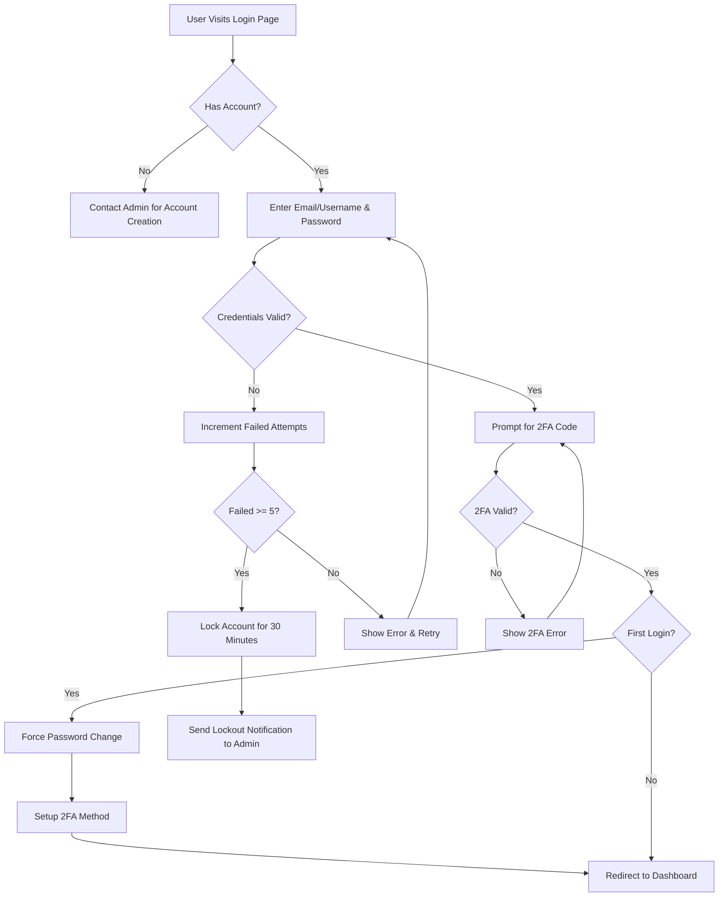

**Business Logic:**

| Rule | Description |
|------|-------------|
| No Self-Registration | System accounts can ONLY be created by administrators |
| Mandatory 2FA | All system users must complete 2FA setup on first login |
| Account Lockout | 5 failed attempts = 30-minute lockout + admin notification |
| Session Timeout | Inactive sessions expire after 30 minutes |
| Password Policy | Min 12 chars, uppercase, lowercase, numbers, special chars |
| Password Expiry | System users must change password every 90 days |

---

### 1.2 Mobile Member Registration & Verification Flow

Mobile app allows self-registration with progressive access based on admin verification.

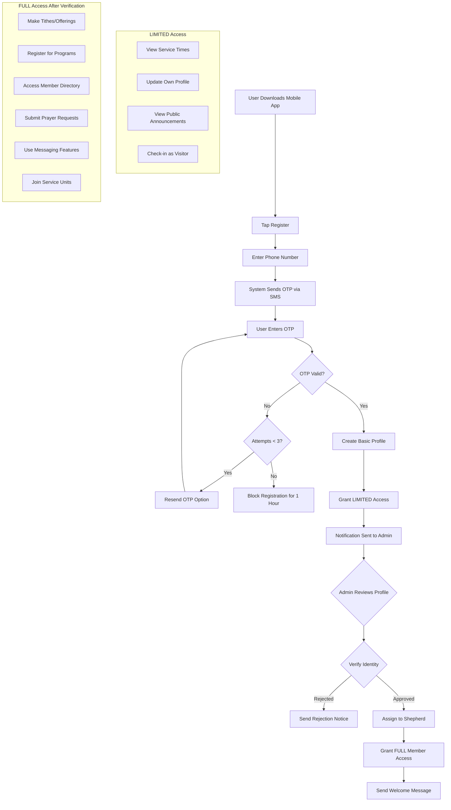

**Access Progression Matrix:**

| Feature | Unverified | Verified Member |
|---------|------------|-----------------|
| View service times | ✅ | ✅ |
| Update own profile | ✅ | ✅ |
| View announcements | ✅ | ✅ |
| Check-in (visitor mode) | ✅ | ✅ |
| Make financial contributions | ❌ | ✅ |
| Register for programs/events | ❌ | ✅ |
| Access member directory | ❌ | ✅ (limited) |
| Submit prayer requests | ❌ | ✅ |
| Use messaging features | ❌ | ✅ |
| Join service units | ❌ | ✅ (with leader approval) |

---

### 1.3 Password Reset Flow

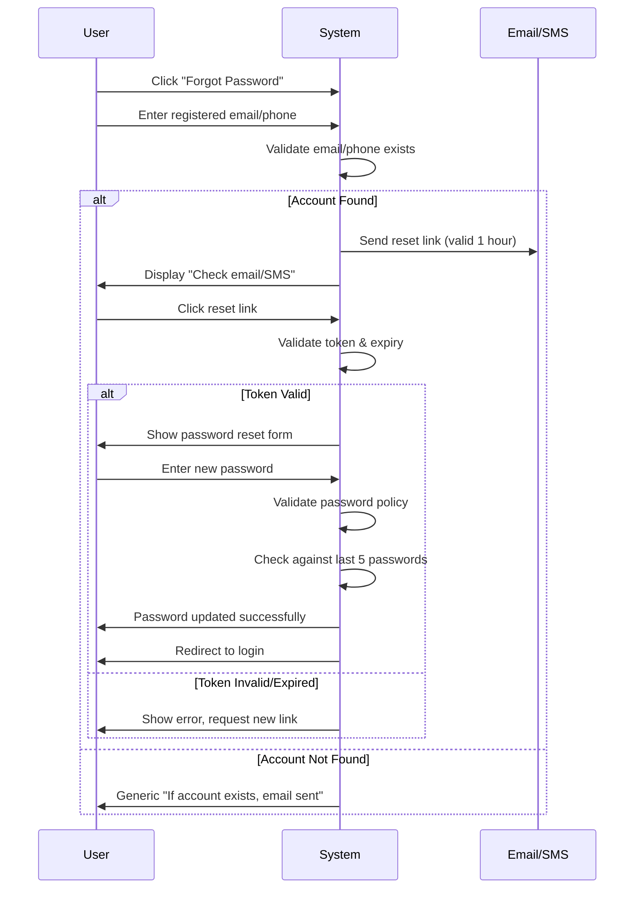

**Security Rules:**
- Reset links expire after 1 hour
- Tokens are single-use
- New password cannot match last 5 passwords
- Generic response prevents account enumeration

---

### 1.4 Role-Based Access Escalation Flow

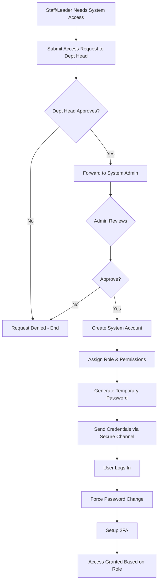

**Role Hierarchy:**

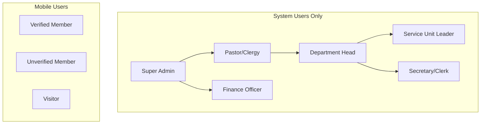

---

## 2. Member Management Flows

### 2.1 New Member Onboarding Flow

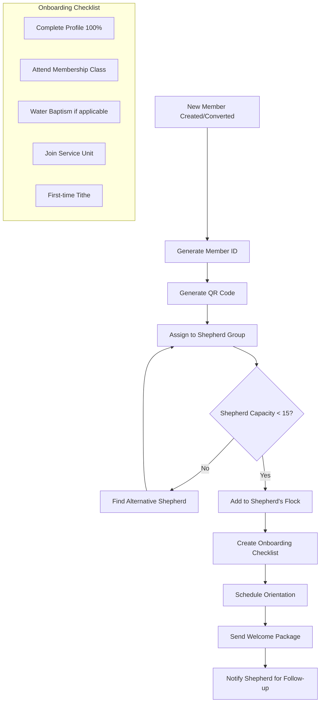

**Onboarding Stages:**

| Stage | Trigger | Actions |
|-------|---------|---------|
| Registration | Profile created | Generate ID, QR code, send welcome SMS |
| Assignment | Auto after creation | Assign shepherd (max 12-15 members each) |
| Orientation | Scheduled by admin | Add to orientation class |
| Integration | After orientation | Encourage service unit joining |
| Milestone | 1 year anniversary | Recognition, review engagement |

---

### 2.2 Visitor to Member Conversion Flow (5-Visit Rule)

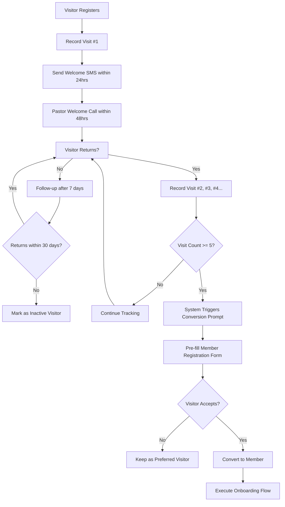

**Visit Tracking Logic:**

```
IF visitor.visit_count >= 5 AND visitor.status == 'active' THEN
    trigger_conversion_prompt()
    prefill_member_form(visitor.profile)
    notify_admin("Conversion candidate: " + visitor.name)
END IF

TRACK visit_history:
    - Visit date/time
    - Service type attended
    - Days between visits
    - Follow-up actions taken
```

---

### 2.3 Family Management Flow

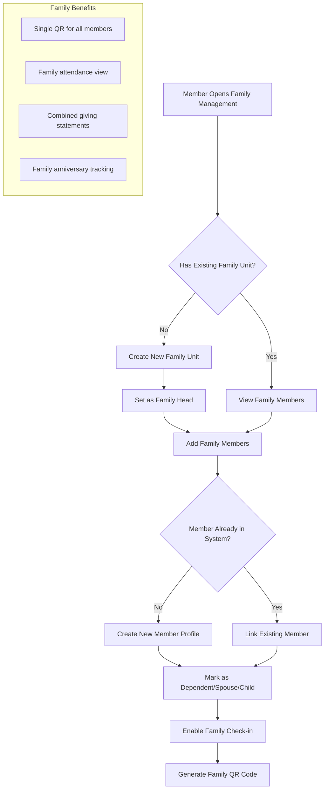

---

## 3. Attendance & Check-in Flows

### 3.1 QR Code Service Check-in Flow

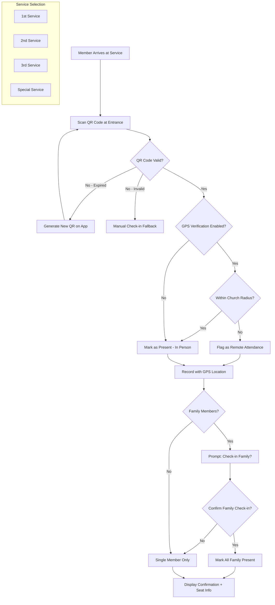

**Check-in Business Rules:**

| Rule | Value | Description |
|------|-------|-------------|
| GPS Radius | 100 meters | Church location verification |
| QR Validity | Per service | Codes expire after service ends |
| Late Threshold | 30 minutes | After service start = marked "Late" |
| Family Check-in | Single scan | One QR checks in entire family |
| Duplicate Prevention | Session-based | Cannot check-in twice for same service |

---

### 3.2 Manual Attendance Marking Flow

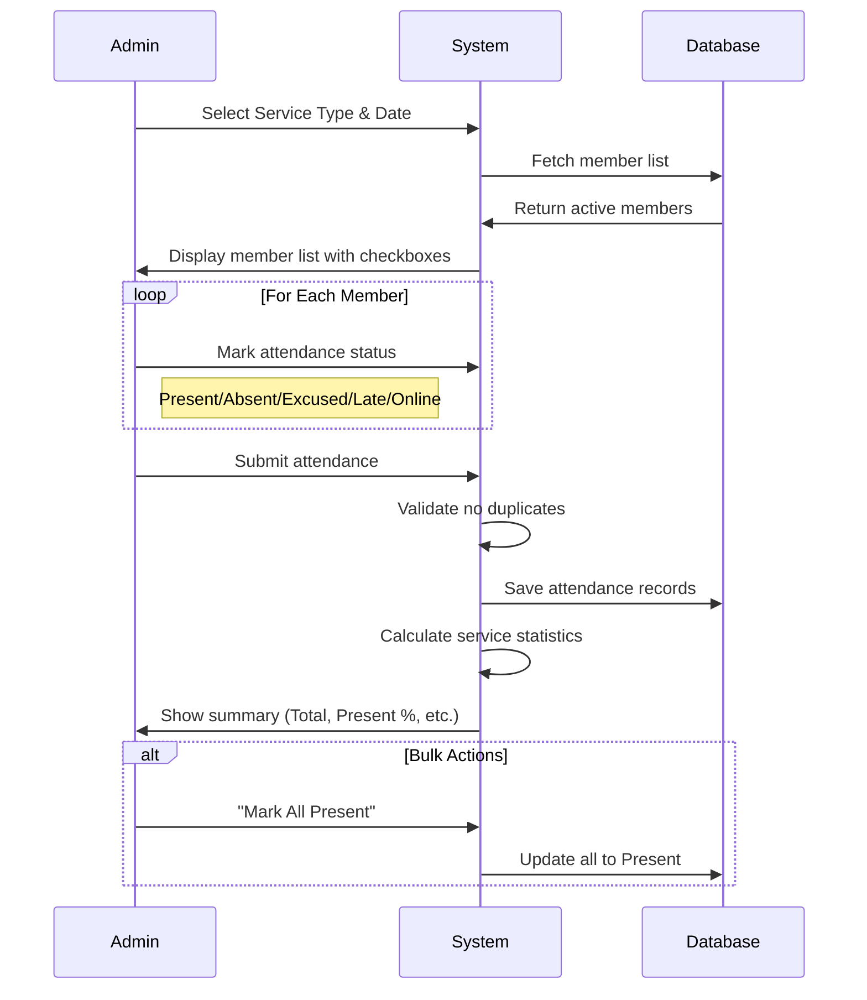

---

### 3.3 Children's Ministry Secure Check-in/Check-out Flow

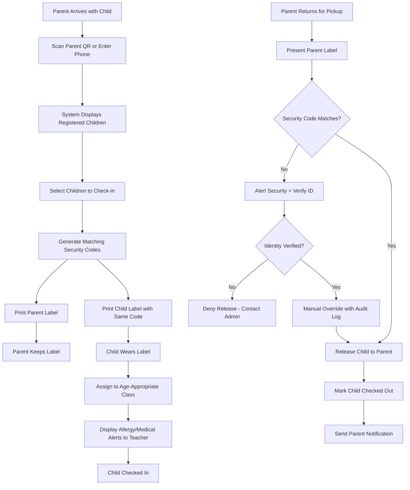

**Security Code Logic:**

```
FUNCTION generate_security_code():
    code = random(1000, 9999)  # 4-digit unique code
    WHILE code_exists_today(code):
        code = random(1000, 9999)
    RETURN code

CHECK-OUT VALIDATION:
    IF parent_code != child_code THEN
        log_security_alert()
        require_manual_verification()
        notify_security_team()
    END IF
```

**Age-Based Class Assignment:**

| Age Range | Class Name | Teacher Ratio |
|-----------|------------|---------------|
| 0-2 years | Nursery | 1:3 |
| 3-4 years | Toddlers | 1:4 |
| 5-6 years | Beginners | 1:6 |
| 7-9 years | Primary | 1:8 |
| 10-12 years | Juniors | 1:10 |
| 13-17 years | Teens | 1:12 |

---

## 4. Financial Transaction Flows

### 4.1 Mobile Giving Flow (Tithe/Offering)

```mermaid
flowchart TD
    A[Member Opens Mobile App] --> B[Tap "Give"]
    B --> C{Member Verified?}
    C -->|No| D[Prompt to Complete Verification]
    C -->|Yes| E[Select Giving Type]
    E --> F{Type Selected}
    F -->|Tithe| G[Pre-calculate 10% of Income Option]
    F -->|Offering| H[Enter Custom Amount]
    F -->|Pledge| I[Select Existing Pledge]
    F -->|Project| J[Select Project Campaign]
    G --> K[Enter/Confirm Amount]
    H --> K
    I --> K
    J --> K
    K --> L[Select Payment Method]
    L --> M{Payment Method}
    M -->|Mobile Money| N[Redirect to Paystack/Flutterwave]
    M -->|Card| O[Enter Card Details]
    M -->|Bank Transfer| P[Display Bank Details + Reference]
    N --> Q[Process Payment]
    O --> Q
    Q --> R{Payment Successful?}
    R -->|No| S[Show Error + Retry Option]
    R -->|Yes| T[Record Transaction]
    T --> U[Generate Digital Receipt]
    U --> V[Send Receipt via SMS/Email]
    V --> W[Update Member Giving History]
    P --> X[Manual Verification Required]
```

**Giving Categories:**

| Category | Description | Allocation |
|----------|-------------|------------|
| Tithe | 10% of income | General Fund |
| Offering | Voluntary amount | Operations |
| Pledge | Commitment payments | As specified |
| Building Fund | Construction projects | Capital |
| Missions | Evangelism support | Missions |
| Welfare | Member assistance | Welfare Fund |

---

### 4.2 Transaction Approval Workflow

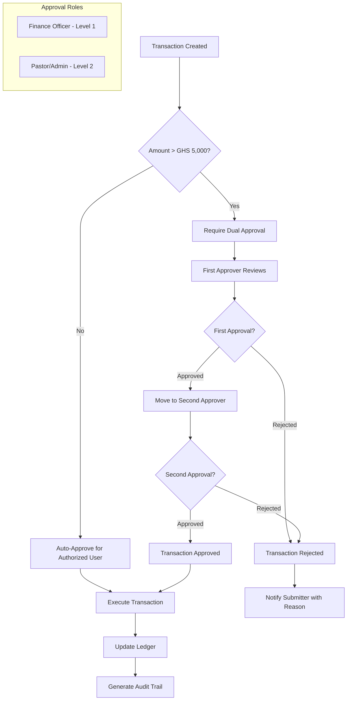

**Approval Thresholds:**

| Amount Range (GHS) | Approval Required |
|--------------------|-------------------|
| 0 - 1,000 | Secretary/Clerk |
| 1,001 - 5,000 | Finance Officer |
| 5,001 - 20,000 | Finance Officer + Pastor |
| 20,001+ | Finance Officer + Pastor + Admin |

---

### 4.3 Expense Submission & Reimbursement Flow

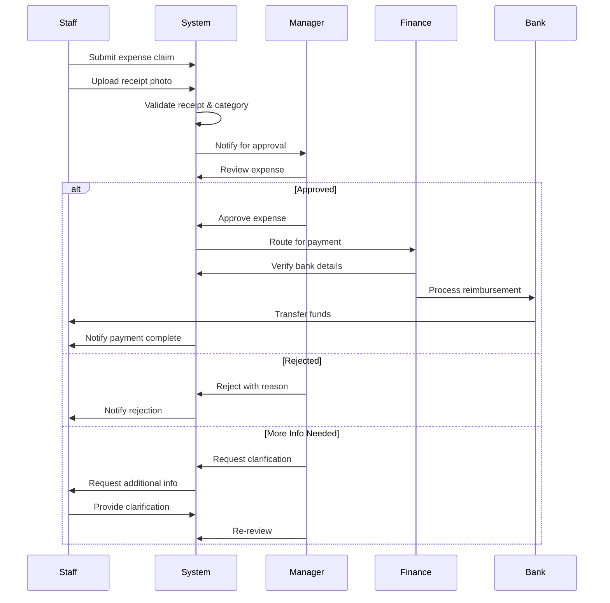

---

## 5. Communication Flows

### 5.1 SMS Broadcast Flow

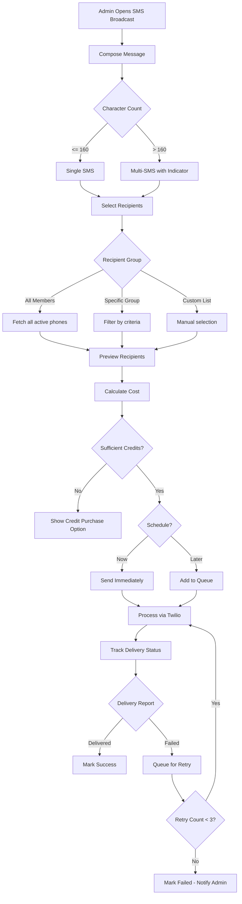

**Message Template Variables:**

| Variable | Description | Example |
|----------|-------------|---------|
| `{{first_name}}` | Member's first name | John |
| `{{last_name}}` | Member's last name | Doe |
| `{{service_time}}` | Next service time | 9:00 AM |
| `{{event_name}}` | Event title | Youth Conference |
| `{{event_date}}` | Event date | 25th January |
| `{{church_name}}` | Church name | Grace Chapel |

---

### 5.2 Birthday/Anniversary Automation Flow

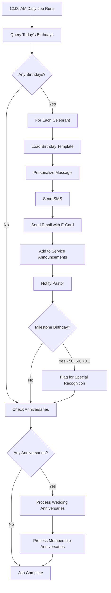

**Milestone Configuration:**

| Event | Milestone Years | Special Actions |
|-------|-----------------|-----------------|
| Birthday | 18, 21, 50, 60, 70, 80+ | Certificate, special prayer |
| Wedding Anniversary | 25, 50 | Recognition in service |
| Membership | 5, 10, 25, 50 | Award, certificate |

---

### 5.3 Prayer Request Submission & Response Flow

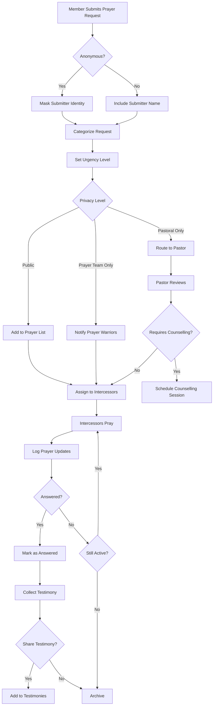

**Request Categories & Assignment:**

| Category | Priority Score | Default Assignees |
|----------|---------------|-------------------|
| Health/Healing | High | 3 intercessors |
| Family | Medium | 2 intercessors |
| Financial | Medium | 2 intercessors |
| Spiritual Growth | Normal | 1 intercessor |
| Career/Work | Normal | 1 intercessor |
| Emergency | Urgent | All available + Pastor |

---

## 6. Ministry-Specific Flows

### 6.1 Shepherd Flock Management Flow

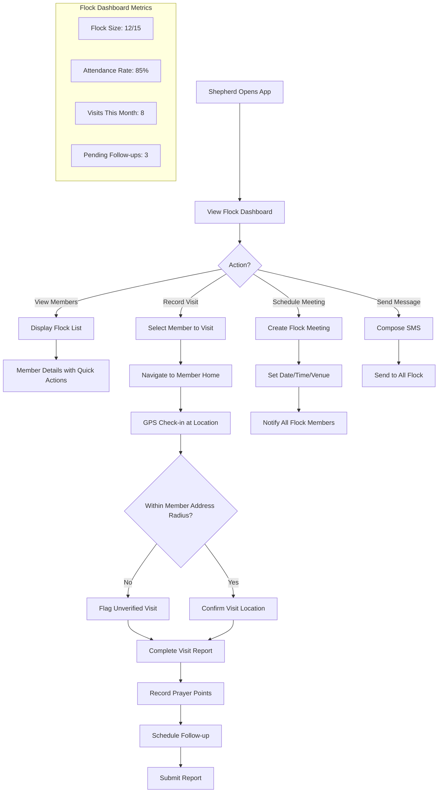

**Shepherd Performance Metrics:**

| Metric | Target | Calculation |
|--------|--------|-------------|
| Flock Attendance | > 80% | Flock present / Total flock members |
| Visitation Rate | 1 per member/month | Visits completed / Members |
| Report Submission | 100% weekly | Reports submitted on time |
| Member Retention | > 95% | Active members / Total assigned |

---

### 6.2 Service Unit Duty Roster Flow

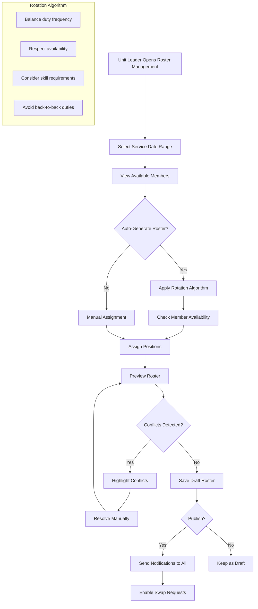

**Duty Swap Request Flow:**

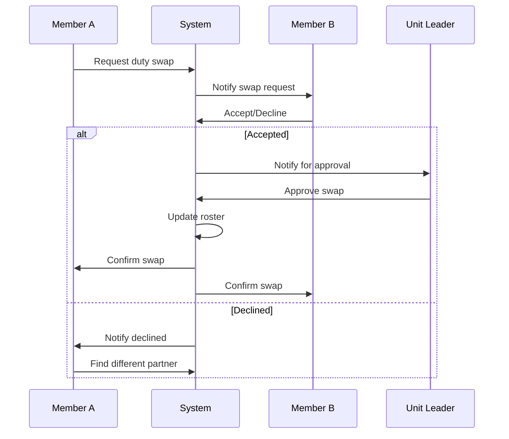

---

### 6.3 Counselling Session Booking Flow

```mermaid
flowchart TD
    A[Member Requests Counselling] --> B[Select Issue Category]
    B --> C[Set Urgency Level]
    C --> D[Choose Communication Mode]
    D --> E{Specific Counsellor Preference?}
    E -->|Yes| F[Check Counsellor Availability]
    E -->|No| G[Auto-Match Based on Specialty]
    F --> H{Available Slots?}
    G --> H
    H -->|No| I[Show Alternative Counsellors]
    I --> F
    H -->|Yes| J[Select Time Slot]
    J --> K[Submit Booking Request]
    K --> L[Counsellor Notified]
    L --> M{Counsellor Confirms?}
    M -->|No| N[Suggest Alternative Times]
    N --> J
    M -->|Yes| O[Session Confirmed]
    O --> P[Send Reminders]
    P --> Q[Day of Session]
    Q --> R[Conduct Session]
    R --> S[Record Encrypted Notes]
    S --> T{Follow-up Needed?}
    T -->|Yes| U[Schedule Next Session]
    T -->|No| V[Close Session]
```

**Counsellor Matching Logic:**

```
FUNCTION match_counsellor(request):
    candidates = get_counsellors_by_specialty(request.category)
    
    # Apply filters
    IF request.gender_preference:
        candidates = filter_by_gender(candidates, request.gender_preference)
    
    IF request.language:
        candidates = filter_by_language(candidates, request.language)
    
    # Sort by workload (fewer active cases = higher priority)
    candidates = sort_by_workload(candidates, ascending=True)
    
    # Return top available counsellor
    FOR counsellor IN candidates:
        IF has_available_slot(counsellor, request.preferred_times):
            RETURN counsellor
    
    RETURN None  # No match found
```

---

### 6.4 Welfare Case Management Flow

```mermaid
flowchart TD
    A[Case Submitted] --> B[Initial Review]
    B --> C[Assign Case Worker]
    C --> D[Home Visitation]
    D --> E[Collect Documentation]
    E --> F[Financial Assessment]
    F --> G[Calculate Priority Score]
    G --> H{Score >= Threshold?}
    H -->|No| I[Recommend Rejection]
    H -->|Yes| J[Prepare Recommendation]
    I --> K[Welfare Committee Review]
    J --> K
    K --> L{Committee Decision}
    L -->|Rejected| M[Notify Applicant with Reason]
    L -->|Approved| N[Allocate Funds]
    N --> O[Disburse Assistance]
    O --> P[Track Beneficiary Progress]
    P --> Q{Case Goals Met?}
    Q -->|No| R[Continue Support]
    R --> P
    Q -->|Yes| S[Graduate from Program]
    S --> T[Collect Testimony]
```

**Priority Scoring Algorithm:**

| Factor | Weight | Score Range |
|--------|--------|-------------|
| Urgency | 30% | 1-10 |
| Financial Need | 25% | 1-10 |
| Family Situation | 20% | 1-10 |
| Church Involvement | 15% | 1-10 |
| Prior Assistance | 10% | 1-10 (inverse) |

```
PRIORITY_SCORE = (Urgency * 0.30) + (FinancialNeed * 0.25) + 
                 (FamilySituation * 0.20) + (ChurchInvolvement * 0.15) + 
                 ((10 - PriorAssistance) * 0.10)

THRESHOLD = 6.0  // Minimum score for approval consideration
```

---

### 6.5 Program/Event Registration Flow

```mermaid
flowchart TD
    A[Program Published] --> B[Member Views Program]
    B --> C{Registration Required?}
    C -->|No| D[Open Attendance - Just Show Up]
    C -->|Yes| E{Registration Open?}
    E -->|No| F[Show Registration Dates]
    E -->|Yes| G{Member Eligible?}
    G -->|No| H[Show Eligibility Requirements]
    G -->|Yes| I{Fee Required?}
    I -->|No| J[Simple Registration Form]
    I -->|Yes| K[Registration + Payment Form]
    J --> L[Submit Registration]
    K --> M[Process Payment]
    M --> N{Payment Successful?}
    N -->|No| O[Show Payment Error]
    O --> K
    N -->|Yes| L
    L --> P{Capacity Available?}
    P -->|No| Q[Add to Waitlist]
    P -->|Yes| R[Confirm Registration]
    R --> S[Generate QR Ticket]
    S --> T[Send Confirmation]
    Q --> U[Notify When Spot Opens]
    U --> V{Accept Spot?}
    V -->|Yes| R
    V -->|No| W[Remove from Waitlist]
```

**Registration State Machine:**

```mermaid
stateDiagram-v2
    [*] --> Browsing
    Browsing --> Registering : Click Register
    Registering --> PaymentPending : Fee Required
    Registering --> Registered : No Fee
    PaymentPending --> Registered : Payment Success
    PaymentPending --> PaymentFailed : Payment Error
    PaymentFailed --> PaymentPending : Retry
    PaymentFailed --> Cancelled : Give Up
    Registered --> CheckedIn : Scan QR at Event
    Registered --> NoShow : Event Ends Without Check-in
    Registered --> Waitlisted : Capacity Full
    Waitlisted --> Registered : Spot Opens
    CheckedIn --> Completed : Event Ends
    Completed --> [*]
    NoShow --> [*]
    Cancelled --> [*]
```

---

## 7. Administrative Flows

### 7.1 Report Generation & Scheduling Flow

```mermaid
flowchart TD
    A[Admin Opens Reports Module] --> B{Report Type}
    B -->|Standard Report| C[Select Report Category]
    C --> D[Set Date Range & Filters]
    D --> E[Generate Report]
    B -->|Custom Report| F[Open Report Builder]
    F --> G[Drag-Drop Fields]
    G --> H[Configure Filters]
    H --> I[Add Calculations]
    I --> J[Preview Report]
    J --> K{Save as Template?}
    K -->|Yes| L[Save Template]
    K -->|No| E
    L --> E
    E --> M[View Report Results]
    M --> N{Export?}
    N -->|PDF| O[Generate PDF]
    N -->|Excel| P[Generate Excel]
    N -->|CSV| Q[Generate CSV]
    N -->|Schedule| R[Configure Schedule]
    R --> S[Set Frequency]
    S --> T[Add Recipients]
    T --> U[Save Schedule]
    U --> V[Auto-Generate & Email]
```

**Report Scheduling Options:**

| Frequency | Trigger | Use Case |
|-----------|---------|----------|
| Daily | 6:00 AM | Attendance summary |
| Weekly | Sunday 11:59 PM | Weekly giving report |
| Monthly | 1st of month | Financial statements |
| Quarterly | End of quarter | Performance review |
| Annual | January 1st | Year-end summary |

---

### 7.2 QR Code Management Flow

```mermaid
flowchart TD
    A[Admin Opens QR Management] --> B{Action}
    B -->|Generate New| C[Select QR Type]
    C --> D{QR Type}
    D -->|Member| E[Select Member]
    D -->|Service| F[Configure Service QR]
    D -->|Equipment| G[Select Equipment]
    D -->|Event| H[Select Event]
    E --> I[Set Expiry Options]
    F --> I
    G --> I
    H --> I
    I --> J{Expiry Type}
    J -->|Never| K[Generate Permanent QR]
    J -->|Time-Limited| L[Set Expiry Date/Time]
    J -->|One-Time Use| M[Generate Single-Use QR]
    K --> N[Generate & Store QR]
    L --> N
    M --> N
    N --> O[Download/Print Options]
    B -->|Revoke| P[Search Existing QR]
    P --> Q[Select QR to Revoke]
    Q --> R[Confirm Revocation]
    R --> S[Mark QR as Invalid]
    S --> T[Audit Log Entry]
    B -->|View Analytics| U[Display QR Scan Statistics]
```

**QR Code Types & Uses:**

| QR Type | Purpose | Typical Expiry |
|---------|---------|----------------|
| Member QR | Attendance check-in | Never (tied to member) |
| Service QR | Service attendance | End of service |
| Equipment QR | Asset tracking | Never |
| Event QR | Event registration/check-in | Event end date |
| Payment QR | Mobile giving link | Never |

---

### 7.3 Equipment Check-out/Return Flow

```mermaid
flowchart TD
    A[Staff Scans Equipment QR] --> B[Display Equipment Details]
    B --> C{Equipment Status}
    C -->|Available| D[Show Checkout Form]
    C -->|Checked Out| E[Show Current Borrower]
    C -->|Maintenance| F[Show Maintenance Schedule]
    D --> G[Enter Checkout Details]
    G --> H[Expected Return Date]
    H --> I[Confirm Checkout]
    I --> J[Update Equipment Status]
    J --> K[Send Confirmation to Borrower]
    E --> L{Same Borrower Returning?}
    L -->|Yes| M[Process Return]
    L -->|No| N[Contact Current Borrower]
    M --> O[Scan Equipment QR Again]
    O --> P[Condition Check]
    P --> Q{Condition OK?}
    Q -->|Yes| R[Mark as Available]
    Q -->|No| S[Report Damage]
    S --> T[Create Maintenance Request]
    T --> U[Mark as Under Maintenance]
    R --> V[Send Return Confirmation]
    U --> V
```

**Equipment Checkout Rules:**

```
MAX_CHECKOUT_DAYS = 7
OVERDUE_REMINDER_DAYS = [1, 3, 5]  # Days after due date

FUNCTION check_overdue_items():
    FOR item IN checked_out_equipment:
        IF item.due_date < today():
            days_overdue = today() - item.due_date
            IF days_overdue IN OVERDUE_REMINDER_DAYS:
                send_reminder(item.borrower)
            IF days_overdue > 7:
                escalate_to_admin(item)
```

---

### 7.4 System Backup & Recovery Flow

```mermaid
flowchart TD
    A[Admin Opens Backup Settings] --> B{Action}
    B -->|Manual Backup| C[Select Backup Type]
    C --> D{Backup Scope}
    D -->|Full| E[Database + Files + Config]
    D -->|Database Only| F[Database Dump]
    D -->|Files Only| G[Media & Documents]
    E --> H[Start Backup Process]
    F --> H
    G --> H
    H --> I[Compress & Encrypt]
    I --> J[Store Backup File]
    J --> K{Cloud Upload?}
    K -->|Yes| L[Upload to AWS S3]
    K -->|No| M[Local Storage Only]
    L --> N[Backup Complete]
    M --> N
    
    B -->|Schedule Backup| O[Configure Schedule]
    O --> P[Set Frequency]
    P --> Q[Set Retention Policy]
    Q --> R[Enable Auto-Delete Old Backups]
    
    B -->|Restore| S[List Available Backups]
    S --> T[Select Backup to Restore]
    T --> U[Verify Backup Integrity]
    U --> V{Integrity OK?}
    V -->|No| W[Backup Corrupted - Use Different]
    V -->|Yes| X[Confirm Restore]
    X --> Y[⚠️ Current Data Will Be Overwritten]
    Y --> Z[Execute Restore]
    Z --> AA[Verify Restored Data]
```

**Backup Retention Policy:**

| Backup Type | Frequency | Retention |
|-------------|-----------|-----------|
| Daily | Every day at 2:00 AM | 7 days |
| Weekly | Every Sunday 3:00 AM | 4 weeks |
| Monthly | 1st of month 4:00 AM | 12 months |
| Annual | January 1st 5:00 AM | 7 years |

---

## Summary: Key Decision Points

| Flow Category | Critical Decision | Business Impact |
|---------------|-------------------|-----------------|
| Authentication | Failed attempts >= 5 | Account lockout, admin notification |
| Member Registration | Admin verification | Access level (limited vs full) |
| Attendance | GPS verification | In-person vs remote attendance |
| Financial | Amount > GHS 5,000 | Single vs dual approval required |
| Children's Ministry | Security code match | Child release or security alert |
| Visitor Tracking | Visit count >= 5 | Conversion prompt triggered |
| Welfare | Priority score >= 6.0 | Case approved for committee review |
| Equipment | Condition check fail | Maintenance workflow triggered |

---

## Related Documentation

- [API Documentation](file:///c:/xampp/htdocs/church-cms-docs/SKILL.md)
- [Authentication System](file:///c:/xampp/htdocs/church-cms-docs/docs/project-documentation/06_AUTHENTICATION_COMPLETE.md)
- [Feature Modules](file:///c:/xampp/htdocs/church-cms-docs/docs/project-documentation/07_FEATURE_MODULES_UPDATED.md)
- [Database Design](file:///c:/xampp/htdocs/church-cms-docs/docs/project-documentation/03_DATABASE_DESIGN.md)

---

**Document Version**: 1.0  
**Last Updated**: January 13, 2026  
**Author**: System Documentation
